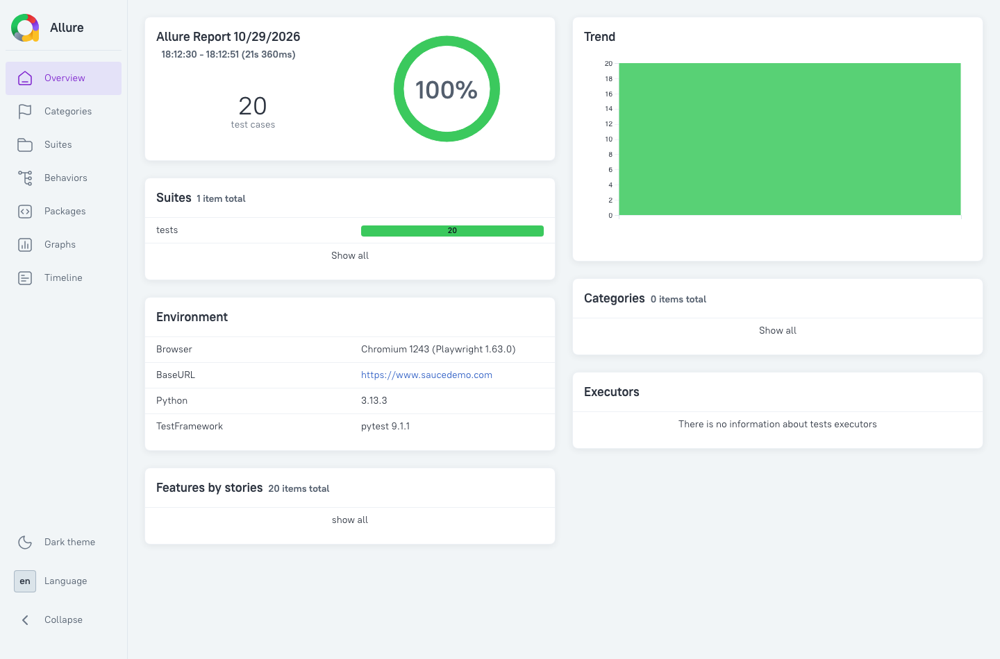
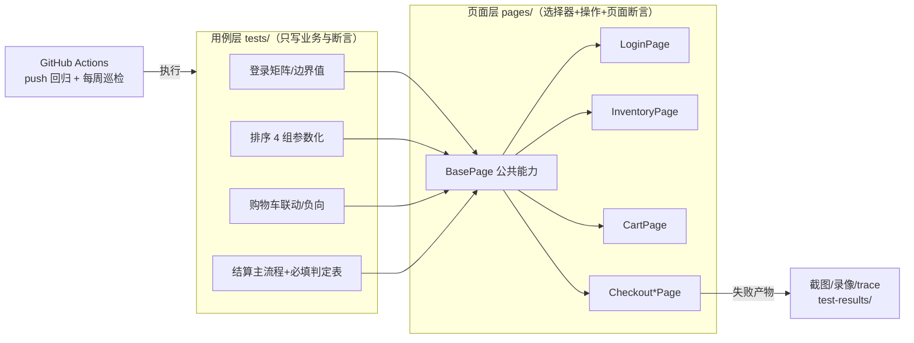

# Swag Labs (saucedemo.com) PO 模式自动化测试

[](https://github.com/wkaixuan588-sudo/saucedemo-pom/actions/workflows/ci.yml)


基于 **Python + Playwright + Pytest** 的 UI 自动化测试项目，采用 **Page Object（PO）模式**，
页面层（`pages/`）与用例层（`tests/`）分离。20 条用例覆盖登录等价类矩阵、商品排序、
购物车操作、结算主流程与必填负向校验；**另由独立探测脚本自动化发现 4 个站点内置缺陷**
（含静默加购失败、图片占位、布局错位、性能劣化），产出正式缺陷报告。

## 效果展示

**结算主流程冒烟运行（有头模式实录）：**


**Allure 报告（20 条 / 100% 通过 / 趋势与执行环境）：**



**核心产出物：**

- 📐 [测试设计说明](docs/test-design.md) —— 方法分布 / 用例覆盖矩阵 / 已知限制
- 🐛 [缺陷报告 ×4](docs/bugs/) —— 编号 / 严重级 / 复现步骤 / 量化证据 / 截图
- 📊 [测试报告](docs/test-report.md) —— 执行统计 / 缺陷汇总 / 风险评估 / 发布结论

## 架构与业务流程



业务主链路：`登录` → `排序/加购` → `购物车` → `收货信息` → `订单总览（金额动态校验）` → `下单`

## 目录结构

```
saucedemo_pom/
├── pages/                          # 页面层：元素定位 + 页面操作 + 页面断言
│   ├── base_page.py                # 页面基类（URL、公共等待/金额解析）
│   ├── login_page.py / inventory_page.py / cart_page.py
│   └── checkout_info/overview/complete_page.py
├── tests/                          # 用例层：只描述业务流程与断言，不写选择器
│   ├── conftest.py                 # 公共夹具
│   ├── data.py                     # 测试数据（账号矩阵、商品目录、错误文案）集中管理
│   ├── test_login.py               # 登录用例（6 账号等价类矩阵 + 边界值）
│   ├── test_sort.py                # 商品排序用例（4 种排序参数化）
│   ├── test_cart.py                # 购物车用例（角标联动 + error_user 静默失败）
│   └── test_checkout_flow.py       # 结算主流程 + 必填负向用例
├── scripts/
│   └── find_defects.py             # 缺陷探测脚本：量化数据 + 截图取证
├── docs/
│   ├── test-design.md              # 测试设计说明（方法/覆盖矩阵/已知限制）
│   ├── test-report.md              # 测试报告（统计/缺陷/风险/结论）
│   ├── bugs/                       # 缺陷报告 ×4 + evidence/ 截图证据
│   └── images/                     # README 用报告截图与运行 GIF
├── .github/workflows/ci.yml        # CI：push 全量回归 + 每周定时巡检
├── pytest.ini                      # pytest 配置（默认有头模式 + 失败截图/录像/trace）
└── requirements.txt                # 依赖清单（锁版本，保证可复现）
```

## 环境准备

```bash
cd saucedemo-pom
python3 -m venv .venv
source .venv/bin/activate
pip install -r requirements.txt
playwright install chromium      # 首次需要下载浏览器
```

## 运行测试

```bash
# 有头模式运行（pytest.ini 已默认 --headed）
pytest

# 仅运行冒烟用例（结算主链路，~2.4s）
pytest -m smoke

# 无头模式全量回归（CI 同款命令）
pytest -o addopts="--browser=chromium"

# Allure 报告
pytest -o addopts="--browser=chromium" --alluredir=allure-results
allure generate allure-results -o allure-report --clean && allure open allure-report

# 缺陷探测与证据采集（docs/bugs/ 报告的数据来源）
.venv/bin/python scripts/find_defects.py

# 失败时自动截图/录像/trace 输出到 test-results/（pytest.ini 已显式配置）
```

## 设计说明

1. **分层**：用例层（`tests/`）只表达业务步骤与业务断言；选择器与元素操作全部收敛在页面层（`pages/`），
   页面改版时只需修改对应页面对象。
2. **选择器**：全部使用站点提供的 `data-test` 属性，稳定且可读；商品名通过 slug 拼接选择器。
3. **等待策略**：saucedemo 为 React 单页应用，URL 跳转完成后 DOM 仍在挂载，
   数据读取方法内置 `wait_for(state="attached")`；断言统一使用 `expect()` 自动重试；
   排序等异步重渲染场景用"哨兵断言"替代固定 sleep。
4. **金额校验**：总览页按 `小计 = Σ单价`、`税费 = 小计 × 8%`、`总价 = 小计 + 税费` 动态计算后与页面比对。
5. **期望值实测先行**：所有错误文案/目录/价格/排序行为先经无头浏览器实地探测再写入断言
   （详见 [docs/test-design.md](docs/test-design.md)），探测经验：购物车存 localStorage，
   探测必须独立浏览器上下文。
6. **缺陷与回归分工**：站点内置缺陷不进回归断言（避免回归永久红），
   由 `scripts/find_defects.py` 专项探测并产出缺陷报告；已修复风险（静默加购失败）固化为负向用例。
