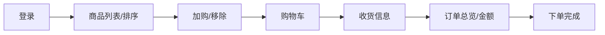

# 测试设计说明

> 对应仓库 `tests/` 目录的 20 条自动化用例。本文说明"为什么测这些、用什么方法测、怎么分工"，
> 以及所有期望值均来自**对站点的实地探测**，而非照抄需求或拍脑袋。

## 一、被测业务与流程图

saucedemo.com（Swag Labs）是一个电商演示站，核心业务链路：

## 二、设计方法与分布

| 方法 | 应用位置 | 说明 |
|---|---|---|
| **等价类划分** | 登录矩阵 | 6 个内置账号按"正常 / 性能异常 / 界面异常 / 功能异常 / 视觉异常 / 锁定"划分等价类，参数化一次覆盖：5 类可登录进入商品页，锁定类报"Sorry, this user has been locked out" |
| **边界值** | 登录空值、角标清零 | 用户名/密码为空、购物车从 1 件减到 0 件（角标消失）等边界状态 |
| **判定表** | 收货信息必填校验 | 三个字段（姓/名/邮编）单缺失 → 对应提示；全空时站点按"First Name 优先"提示，已实测固化 |
| **场景法** | 结算主流程（冒烟） | 登录 → 加购 2 件 → 购物车 → 收货信息 → 总览金额（小计 = Σ单价、税 = 小计×8%、总价 = 小计+税，动态计算断言）→ 下单 → 回首页角标清零 |
| **错误推测** | error_user 静默加购失败 | 实测发现 error_user 有 3 款商品点击加购后**角标不变且无任何报错**——先固化负向用例（对比设计：先加购 1 件正常商品排除会话问题），缺陷报告见 `docs/bugs/` |

## 三、用例覆盖矩阵

| 模块 | 用例 | 数量 | 方法 | 标记 |
|---|---|---|---|---|
| 登录 | test_login_matrix（6 账号参数化） | 6 | 等价类 | smoke* / regression |
| 登录 | 空用户名+空密码 / 空密码 / 错误密码 | 3 | 边界值、错误推测 | regression |
| 排序 | 默认序 / Z-A / 价格升 / 价格降 | 4 | 场景法 | regression |
| 购物车 | 库存页加购移除角标联动 / 购物车页移除 / error_user 静默失败 | 3 | 场景法、错误推测 | regression |
| 结算 | 加购 2 件完整结算主流程 | 1 | 场景法 | **smoke** / regression |
| 结算 | 必填字段单缺失（3 组参数化） | 3 | 判定表 | regression |
| **合计** | | **20** | | |

\* 登录矩阵仅 `standard_user` 分支计入冒烟（smoke 取"核心主链路最小集"：登录成功 + 下单主流程，共 2 条）。

## 四、关键设计决策与已知限制

1. **期望值探测优先**：全部错误文案、商品目录、价格、排序行为先经无头浏览器实地探测验证，
   再写入 `tests/data.py` 作为期望值——断言的是"站点真实行为"，不是"我以为的行为"。
2. **价格同价不排序断言**：$15.99 有两件商品（Bolt T-Shirt / Test.allTheThings T-Shirt），
   站点未定义同价商品间的顺序，价格排序用例只断言价格序列，名称排序才断言完整序列。
3. **排序生效哨兵**：React 页面排序是异步重渲染，先用 `expect_first_item()`（自动重试）
   确认第一件商品变化，再读取全量列表，避免固定 sleep。
4. **performance_glitch_user 拖慢全量回归**（登录约 +5s）：保留在回归中以覆盖性能异常等价类，
   冒烟集不含它。
5. **购物车状态存在 localStorage**：同浏览器上下文跨登录会保留，测试框架每条用例独立上下文天然隔离；
   手工探测时曾因状态残留误判 error_user 行为，已记录为经验（探测要独立上下文）。

## 五、未覆盖（后续迭代）

- 结算总览页的 Cancel 返回路径、continue_shopping 返回路径（次要分支）；
- problem_user 图片 404 / visual_user 布局错位 → 归入缺陷报告（`docs/bugs/`）而非失败用例
  （它们是站点故意埋的缺陷，写进断言会让回归永远红）；
- 多浏览器矩阵（chromium/webkit/firefox）与视觉回归：规划中。
